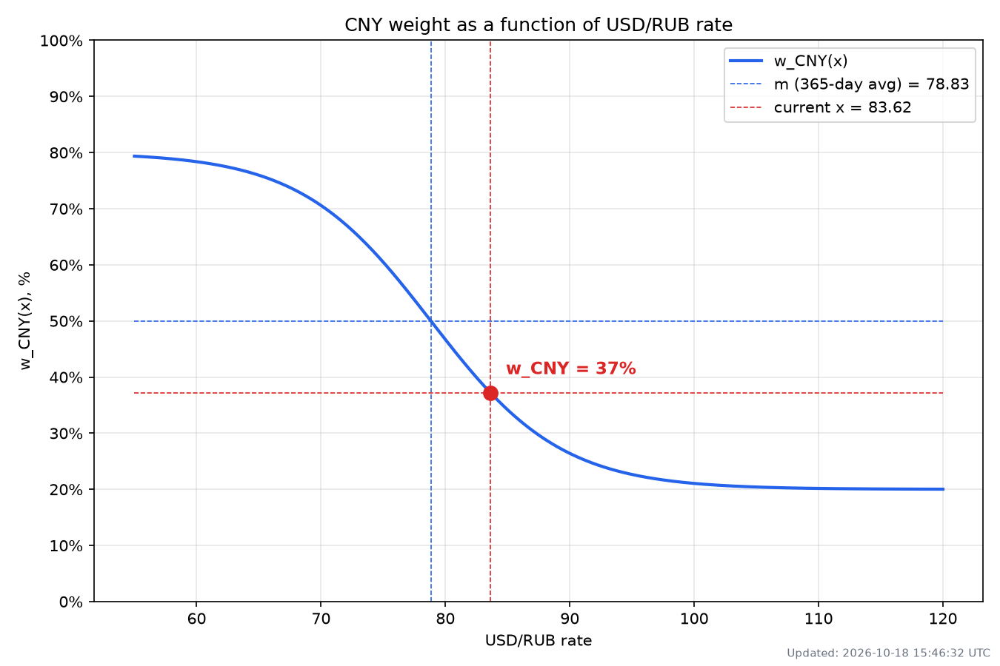
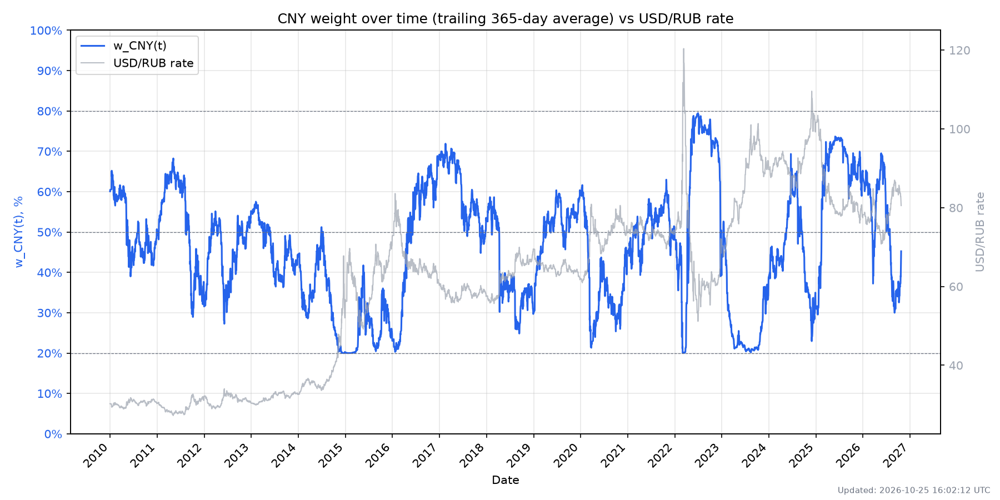

# USD/RUB Weight Report

**Date:** 2026-10-14
**Updated:** 2026-10-14 17:02:11 UTC

- Current USD/RUB rate (x): **83.9497**
- 365-day average USD/RUB rate (m): **78.8018**
- w_CNY(x): **36%**
- w_RUB(x): **64%**

